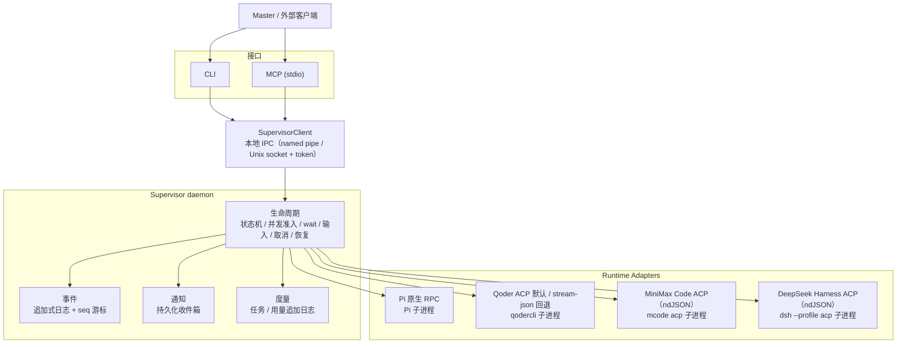

<div align="center">

# Harness Supervisor

     

<hr />

**本地、轻量、运行时无关的 Agent Worker 生命周期与通信层**

主 Agent（下称 **Master**）通过 **CLI** 或 **MCP** 启动、观察、指导、取消和恢复其他厂商的原生 Harness；每个被启动的 Harness 进程称为 **Worker**。HS 只管理进程、会话与事件；规划、工具调用和上下文管理由各 Harness 自己完成。

</div>

## 核心理念

HS 的目标：以尽可能低的开销，让独立的原生 Harness Worker 被可靠地调用、观察、控制和协作。

**不做**

- 新的 Agent 框架或 Agent Loop；
- Planner / Reviewer / Challenger 等角色拆分；
- 任务 DAG、投票、模型路由或固定工作流；
- Harness 内部的规划、工具调用与上下文管理；
- 额外 LLM 做调度或生命周期管理；
- 多用户、远程调度、配额管理或安全沙箱。

**设计原则**

- **原生优先**：优先使用运行时原生协议、Session 与控制能力；不为统一接口伪造底层不支持的行为。
- **提供能力，不规定工作流**：任务如何拆分、是否多轮协作，由 Master 自行决定。
- **状态来自证据**：`completed` 只在 Harness 报告 settle、或进程退出被确认后出现。
- **先落盘再交付**：重要事件与通知先写入本地追加日志，消费者离线不丢。

## 当前接入

| Runtime | 传输 | 状态 |
| --- | --- | --- |
| Pi Agent | Pi 原生 RPC（Pi v1.3+） | 完整支持 |
| Qoder CLI | 官方 ACP 默认，stream-json 可回退 | 实验性 |
| MiniMax Code | ACP over ndJSON | 实验性 |
| DeepSeek Harness / DSH | 官方 ACP（`dsh --profile acp`） | PoC |

## 功能

- **独立 Worker**：每个 Worker 是一个原生 Harness 子进程，有自己的 cwd、session 与进程树。Worker 属于 daemon，客户端断开后继续运行。
- **完整生命周期**：spawn / status / events / wait / send / answer / cancel / resume，含并发准入、取消与关停屏障、重启对账。
- **增量事件**：每 Worker 一条追加式事件流，`seq` 单调递增，支持 `sinceSeq` 游标；状态变化与普通进度分开返回。
- **持久化通知收件箱**：完成 / 失败 / 取消 / 需要输入 / 崩溃 / 失联等事件生成稳定 ID 的通知，可查询、可确认、跨重启不重复；默认不产生任何外部调用。
- **可选队列投递**：登记 Codex thread 后，可用官方 `codex queue` 把简短通知写入该 thread；是否真正唤醒 Master 取决于宿主是否加载该 thread。
- **可选请求幂等**：`spawn` / `resume` / `send` 支持 `requestId`；重复请求不会重复执行，结果不确定时报 `UNCERTAIN`。
- **任务度量**：每次 `spawn` 自动创建或关联一个委托任务；记录 Worker 终态、耗时、可得的运行时 Token 用量，并生成带覆盖率、来源和未知字段的单任务/汇总报告。费用不采集，验收、返工与干预尚未采集。
- **Qoder 双传输**：默认使用官方 ACP，可回退 stream-json；两种传输的会话句柄不互换，能力差异如实报告。
- **DSH ACP 接入**：支持 spawn / 事件 / 取消 / `session/resume` / 模型与推理强度配置 / 权限提权应答；桌面端安装可自动发现，也可用 `HARNESS_SUPERVISOR_DSH_ENTRY` 指定入口。
- **统一入口**：CLI、MCP、IPC 共享同一个 daemon 与同一份状态。

## 架构



| 模块 | 职责 |
| --- | --- |
| `src/adapters/` | Pi / Qoder / MiniMax Code / DSH 的运行时适配，以及通用 ACP ndJSON 传输 |
| `src/supervisor.ts` | 状态机、wait、send/answer、cancel、resume、重启对账 |
| `src/store.ts` | Worker 记录、追加式事件日志、游标、持久化 |
| `src/metrics.ts` | 任务/用量记录、独立追加日志、覆盖率与报告计算 |
| `src/notify.ts` | 通知收件箱、确认、可选投递与重试 |
| `src/ipc/` | 本地 IPC、token 认证、server/client |
| `src/cli.ts` / `src/mcp.ts` | 两个入口，共用同一套核心行为 |
| `src/types.ts` | 公开类型、状态与事件 schema |

## 工作原理

1. **进程归属**：daemon 启动 Harness 子进程并持有其 stdio；CLI/MCP 只是客户端，断开不影响 Worker。
2. **Adapter 只做翻译**：把 Harness 原生事件映射为统一事件，把统一指令映射为原生命令，保留运行时自己的语义。
3. **状态来自证据**：`spawn` 返回只表示 prompt 被接受；`completed` 只在 Harness 报告 settle、或进程退出被确认后出现。
4. **恢复显式且受限**：daemon 重启不会接管原进程；`resume` 使用“新进程 + 加载持久化 session + 新 prompt”，并校验 session，不重放旧操作。
5. **先落盘再交付**：重要事件与通知写入本地追加日志；投递语义为 at-least-once。

## 快速开始

要求：Node.js >= 22.19；Pi >= 1.3 并已配置 provider/凭据。

```bash
npm install
npm run build
node dist/src/cli.js up          # 启动本地 daemon（已在运行则直接返回）

# 启动 Worker：只表示 prompt 被接受，任务可能仍在运行
node dist/src/cli.js spawn \
  --cwd D:/work/demo \
  --prompt "Create hello.txt containing hello. Then reply exactly DONE." \
  --name demo-worker --json

node dist/src/cli.js status <workerId>       # 状态、最近事件与结果
node dist/src/cli.js wait <workerId> --timeout-ms 60000
node dist/src/cli.js send <workerId> --message "也写一个时间戳" --mode steer
node dist/src/cli.js cancel <workerId>
node dist/src/cli.js resume <workerId> --prompt "继续并总结改动"
node dist/src/cli.js metrics show <taskId>   # 任务状态、Worker 耗时与用量
node dist/src/cli.js metrics report          # 汇总、覆盖率与未知字段
node dist/src/cli.js down                    # 优雅关闭（会取消活动 Worker）
```

默认状态目录为 `~/.harness-supervisor`，可用 `--state-dir <dir>` 或 `HARNESS_SUPERVISOR_HOME` 隔离实例。完整命令见 `node dist/src/cli.js help`，示例见 [`examples/cli-walkthrough.sh`](examples/cli-walkthrough.sh)。

### DSH Master 与可选 WebUI

DSH 插件和核心在同一仓库维护，插件源码位于 [`packages/dsh-plugin`](packages/dsh-plugin/README.md)，安装包独立发布。插件为每个真实 DSH Agent 绑定独立的 `ownerRef` 和 MCP 连接；模型只能操作本会话 Worker 与收件箱 ACK，不继承共享 daemon 的 Codex 通知目标。其他 Master 可使用同一进程配置：

```bash
node dist/src/mcp.js --owner-ref <stable-session-reference> --notify-none
```

旧 Worker 无归属字段，仍可通过全局 CLI 查询，不自动被任何会话认领。归属是协作路由护栏，不是同一操作系统用户之间的安全沙箱。

```bash
harness-sup ui                         # 打开全局人工管理界面
harness-sup ui --owner-ref <reference> # 固定一个会话的界面
harness-sup ui --no-open --json        # 获取一次性浏览器入口
harness-sup ui --stop                  # 关闭 HTTP 与浏览器授权，Worker 继续运行
```

WebUI 默认不开端口，启用时只监听 `127.0.0.1`；同一前端用于系统浏览器、DSH Desktop Browser 页签和本机 DSH Web iframe。支持按工作目录分组、折叠与平铺切换，以及状态、结果、增量事件、Worker 用量、完整输入审批与取消；任务创建与续接仍由 Master 完成。每个 Worker 会话有稳定色块与对应 Harness 的本地图标，资源及许可见 `web/src/assets/harness/`。入口在 60 秒内兑换一次，浏览器 API 使用独立 Bearer 凭证，不接触 IPC Token。页面刷新保留当前页授权，daemon/UI 重启后需重新从可信入口打开。页面不唤醒模型，也不自动 ACK。

插件升级提供固定的配套核心候选；在 DSH 设置中点击“应用配套 HS 核心”后，daemon 暂停新任务准入，既有任务、审批和队列继续执行。排空阶段可取消更新；真正切换时会短暂拒绝写操作，并使旧 UI 授权失效。候选核心、生产依赖和静态页面复制到经过哈希校验的不可变缓存，插件关闭或卸载不停止共享 Worker。

CLI 同样支持 `runtime prepare --source <package-root>`、`runtime apply --runtime-id <id> --intent-id <key>`、`runtime status` 与 `runtime cancel --intent-id <key>`。无法确认进程退出时停止自动切换；不要通过删除锁或并行拉起旧核心强行恢复。`runtime-update.json` 和 `runtime-update.log` 保留恢复线索，`runtime-backups/` 保留交接前备份。首版只支持兼容状态格式；从 `0.9.2` 首次升级须先安排维护窗口，处理活动 Worker 后手动停止旧 daemon，再启动新版本。开发与发布不会自动升级生产实例。

构建安装包：`npm run build`、`npm run pack:core`，再在插件目录运行 `npm run pack:release -- --core-tarball ../../.artifacts/harness-supervisor-0.10.0.tgz`。发布包携带锁定的生产依赖，安装不需要源码构建或全局 HS。

### 全新 clone / 另一台机器

仓库只包含源码、测试与文档；`dist/` 被 `.gitignore` 忽略，必须在本机构建。

```bash
git clone --branch main https://gitcode.com/chenpi_1/harness-supervisor.git Harness-Supervisor
cd Harness-Supervisor
npm ci                 # 按 package-lock.json 安装，可复现
npm run build          # 生成 dist/（核心 + 共用 WebUI）
npm run typecheck      # 可选：类型检查
node dist/src/cli.js up
node dist/src/cli.js info        # 核对 version=0.10.0 与 stateDir
```

若 `npm ci` 因网络镜像失败，改用 `npm install`，再用 `git status` 确认 `package-lock.json` 未被意外改写。

本机状态与凭据不会随 Git 迁移：状态目录（Worker 记录、事件日志、session、收件箱）、daemon 进程与 IPC 端点、MCP 客户端注册、各 Harness 自己的登录态都必须在本机建立。复制源码不会复制运行状态；缺少凭据时 `spawn` 会失败，这属于运行时的环境问题。

### MCP 接入

MCP server 是 daemon 的客户端；daemon 需要独立启动并保持运行。若宿主会随会话清理 MCP server 的子进程树，不要在宿主内自动拉起 daemon：

```bash
node <clone>/dist/src/cli.js up
```

在宿主支持的任何 stdio MCP 配置中注册以下 server，`command` 与 `args` 指向本机 clone 的绝对路径：

```json
{
  "mcpServers": {
    "harness-supervisor": {
      "command": "node",
      "args": ["<clone>/dist/src/mcp.js"]
    }
  }
}
```

MCP 协议本身不规定客户端配置字段。常见的 `mcpServers` 写法通常只有 `command`、`args`、`env`，工具超时与审批由各客户端自行定义：Codex 使用 `tool_timeout_sec` / `default_tools_approval_mode`，Claude Code 使用每服务器 `timeout` / `MCP_TOOL_TIMEOUT`，Qoder 使用 `timeout` / `trust`，Cursor 主要通过 UI 与 Run Modes 控制审批。请以所用客户端文档为准，JSON 形式可参考 [`examples/mcp.json`](examples/mcp.json)。

这些宿主侧设置只影响宿主如何审批、超时调用 **HS 的 MCP 工具**（`worker_spawn`、`worker_wait` 等），不会改变 Worker 内部的权限；Pi、Qoder、MiniMax Code、DSH 的权限由各自的运行时配置或 HS 环境变量决定。无论使用哪个客户端，工具调用超时都应大于 `worker_wait` 的等待时间。若 daemon 使用 `--state-dir`，MCP 的 args 也要指向同一目录。

### 推荐权限

HS 的推荐默认是让原生 Harness 直接执行完整任务，不为普通文件/命令操作增加人工审批：

| 运行时 | 推荐设置 | 说明 |
| --- | --- | --- |
| Qoder CLI | `HARNESS_SUPERVISOR_QODER_PERMISSION_MODE=bypass_permissions` | ACP 下映射为 `yolo`（Auto-approves all tools）；不设置时也是该默认 |
| MiniMax Code | `HARNESS_SUPERVISOR_MCODE_PERMISSION_MODE=bypassPermissions` | 宿主原生默认；不设置时也是该默认 |
| DSH | `HARNESS_SUPERVISOR_DSH_PERMISSION_MODE=danger-full-access` | 原生默认 `workspace-write` + 审批 `ask`：工作区内写入免审批，工作区外写入会被拒绝并可触发一次性提权。设为 `danger-full-access` 才移除文件沙箱且不再询问；`read-only` 只读。桌面端 UI 的三种模式属于 desktop profile，不会自动传给 ACP |
| Pi | 由 Pi 自身配置决定 | HS 不管理 Pi 的权限模式 |

建议在**启动 daemon 的环境**中显式写出上述值，修改后重启 daemon。只有确实需要逐工具人工审批时，才改为 `default`（Qoder 在 ACP 下会通过 `session/request_permission` 暴露原生选项）。桌面端权限选择器只影响桌面会话。

**边界**：这些模式只表示跳过审批，不提供沙箱隔离。Worker 与 daemon 使用同一 OS 用户，仍可访问该用户可访问的文件、进程和网络；高风险任务应使用真正的隔离环境。

### MCP 输出模式

MCP server 有两种呈现模式，只影响当前 MCP 进程如何返回结果，不改变 daemon、Worker 状态、持久化事件、通知路由或权限边界：

- `production`（默认）：只返回 Master 执行任务所需字段。`status` 是有界状态快照，不返回事件、时间线或完整结果；`wait` 在完成时返回完整最终结果，需要输入时返回 `pendingInput`，超时只返回状态与游标；`until=event` 未指定 `types` 时只等待 lifecycle 事件，progress 不会结束等待；`events` 只返回 lifecycle 摘要，`run.progress` 不会进入 Production；`list` 使用 Keyset 分页。适合日常使用。
- `development`：扩展诊断字段白名单（完整 result/pendingInput、`recentEvents`、`lastProgress`、`timeline`、`stderrTail`、PID/session 引用等），但不是原始内部记录直出。用于排查问题，不进入 Master 的默认调用链。

配置优先级：命令行 `--mode` > 环境变量 `HARNESS_SUPERVISOR_MCP_MODE` > 默认 `production`。非法值会在 MCP 启动时明确报错退出，不会静默降级，也不使用 `NODE_ENV`。

```powershell
$env:HARNESS_SUPERVISOR_MCP_MODE = 'development'   # 或 production
node D:/Projects/Harness-Supervisor/dist/src/mcp.js
```

`production` 的字段精简只服务于上下文预算，不提供安全隔离；完整诊断可在 `development` 或 CLI/IPC 中获取。完整最终结果不会被展示层截断；`result.truncated` 只表示 Supervisor 存储层已按 `maxResultBytes` 截断。

`worker_spawn` 返回样例（接受任务，任务可能仍在运行；`notifyTarget` 是实际持久化目标）：

```json
{"id":"w-xxx","accepted":true,"runtime":"pi","status":"running","lastSeq":5,"notifyTarget":{"channel":"none"}}
```

`worker_wait` 完成时返回样例（完整结果只出现一次；默认不带事件）：

```json
{"worker":{"id":"w-xxx","runtime":"pi","status":"completed","lastSeq":11,"result":{"text":"最终报告全文","truncated":false},"resumeAvailable":true,"session":{"available":true,"restorable":true}},"terminal":true,"timedOut":false,"nextSeq":11,"hasMore":false}
```

`worker_status` 默认是有界快照：只带 `resultPreview`/`errorPreview` 和必要的 `pendingInput`，不带 `recentEvents`、`lastProgress`、`timeline` 或 `inputState`。需要完整待处理输入时显式传 `includeInput=true`；需要完整结果时用 `worker_wait`。完整结果可从 `worker_wait` 获取，事件历史从 `worker_events` 获取。

`worker_list` 返回 `{workers,nextCursor,hasMore}`；把 `nextCursor` 原样传回并保持相同的 `statuses`/`includeArchived` 过滤条件即可遍历完整历史。旧于 0.9.1 的 Daemon 仍可返回第一页；cursor 页会返回带升级指引的 `UNSUPPORTED`，不会把旧严格 Schema 错误直接暴露。

## 接口

### MCP 工具

| 工具 | 用途 |
| --- | --- |
| `worker_spawn` | 启动 Worker；prompt 被接受即返回，不等待完成 |
| `worker_status` | 有界状态快照、pending input 预览、结果/错误预览；完整结果用 `worker_wait` |
| `worker_list` | 列出 Worker（持久化、跨重启）；`{workers,nextCursor,hasMore}` Keyset 分页 |
| `worker_events` | 增量读取 lifecycle 事件；Production 不返回 `run.progress` 或原始 `data` |
| `worker_wait` | 有界等待（默认 30s，最大 120s）；完成时返回完整结果，超时只返回状态与游标 |
| `worker_send` | 运行中追加 steer / follow-up |
| `worker_answer` | 回答输入请求或权限询问 |
| `worker_cancel` | 取消并确认终态；不影响其他 Worker |
| `worker_resume` | 用新指令恢复已有 session |
| `worker_continue` | 在 idle 的 persistent Worker 上提交下一轮；沿用同一 native session |
| `worker_admin` | pin / unpin、archive / unarchive、retire / unretire |
| `worker_forget` | 删除终态 Worker 的 HS 记录与事件；保留 native session 文件 |
| `supervisor_info` | Production 为版本、模式、runtime 与 Worker 计数快照；完整诊断在 Development |
| `supervisor_notifications` | 读取通知收件箱（production 默认全部未确认；development 默认 pending） |
| `supervisor_notifications_ack` | 确认通知（幂等） |
| `supervisor_wake_target` | 可选：登记 Codex thread 以启用队列投递 |
| `metrics_task_create` | 创建一个可关联多个 Worker 的委托任务 |
| `metrics_task_show` | 单任务状态、耗时、用量摘要、覆盖率与警告；原始 usage 记录仅在 Development 返回 |
| `metrics_report` | 区间汇总（按任务创建时间）、覆盖率、未知字段；`includeTasks` 在 Production 返回任务摘要，Development 返回完整详情 |
| `metrics_record_usage` | 人工补录 Master 或 Worker 用量；支持 `usageId` 幂等 |

### CLI 命令

| 分类 | 命令 | 用途 |
| --- | --- | --- |
| 守护进程 | `up` `down` `daemon` `info` | 启动、关闭、前台运行 daemon，查看版本与状态目录 |
| Worker 管理 | `spawn` `list` `status` `events` | 创建 Worker，列出、查询状态，增量读取事件 |
| Worker 通信 | `wait` `send` `answer` `cancel` `resume` `continue` | 有界等待、追加指令、回答输入、取消、恢复、继续同一 Worker 的下一轮 |
| Worker 管理 | `admin` `forget` | 固定、归档、退役、取消退役；删除 HS 记录但保留 native session |
| 通知 | `inbox` `ack` `notify-target` `retry-notifications` | 读取与确认收件箱，登记投递目标，重试投递 |
| 度量 | `metrics create\|show\|report\|export\|record-usage` | 创建任务，查看单任务/汇总报告，导出，补录用量 |
| 维护 | `prune` `compact` | 清理终态且没有未确认通知的 Worker；压缩终态 Worker 的旧进度事件 |

### 状态与事件

| 类别 | 值 |
| --- | --- |
| 非终态 | `starting` `running` `awaiting_input` |
| 终态 | `completed` `failed` `cancelled` `crashed` `orphaned` `interrupted` |
| Worker 事件 | `worker.starting` `worker.started` `worker.session` |
| 运行事件 | `run.accepted` `run.started` `run.progress` `run.usage` `run.needs_input` `run.input_answered` `run.message_sent` `run.error` `run.completed` `run.failed` `run.cancelled` |
| 生命周期事件 | `worker.cancel_requested` `worker.exited` `worker.crashed` `worker.orphaned` `worker.interrupted` `worker.resumed` `worker.continued` `worker.resume_failed` |

`run.usage` 是结构化、低频的运行时用量报告；`run.progress` 中旧的 `kind=usage` 仍保留以兼容既有事件消费者，但任务度量只消费 `run.usage`。`run.usage` 只描述 Token，不包含费用。

`orphaned` 表示 daemon 重启后进程可能仍存活但已失去控制；`interrupted` 表示进程已不在或 PID 已被复用。两者都不代表任务成功，也不会被自动重跑。

### 关键语义

| 主题 | 语义 |
| --- | --- |
| `spawn` | 返回时任务尚未完成；终态以 `wait` / `status` 为准 |
| `worker_wait` | 有界等待；超时只表示等待窗口结束，不带游标时应先检查当前状态 |
| `run.message_sent` | 只表示消息被 Harness 接受；模型是否看到或采纳需以事件与结果为准 |
| `resume` | 使用新进程加载持久化 session；不会续接原进程内存，也不会自动重跑中断任务 |
| `continue` | 仅用于 `persistent` Worker；要求同一 session 仍可恢复，拒绝时不会创建替代 Worker |
| `pin` | 保护 Worker 不被 `prune` 或 `forget` 删除 |
| `archive` | 仅从默认 `list` 隐藏；记录、事件与 session 引用保留 |
| `retire` | 停止接受新的 `continue` / `resume`；`unretire` 可恢复 |
| `forget` | 显式删除 HS 记录与事件；native session 文件保留，需无未确认通知 |
| `prune` | 显式维护操作；只清理终态、未 pin 且没有未确认通知的 Worker |
| `compact` | 只处理终态、未 pin、无运行中进程且非 orphaned 的 Worker；保留全部生命周期事件与最新进度，seq 游标不变 |
| `requestId` | 不带 `requestId` 时不具备幂等性；带 `requestId` 时也不提供跨组件的 exactly-once |

### Persistent Worker（开发分支能力）

> 状态：0.9.2。审批、事件交接与通知修复见 [CHANGELOG](CHANGELOG.md)；MCP 返回契约变更与真实 Qoder / MiniMax Code 验收见 [0.9.1 交付报告](docs/2026-11-10-hs-0.9.1-report.md)。

`worker_spawn` 传入 `persistence="persistent"`（CLI 为 `spawn --persistence persistent`）后，Worker 的身份和 native session 会跨 Turn 保留。每轮结束后 Activation 进程退出，`status` 仍记录本轮终态（通常为 `completed`），派生字段 `lifecycle` 变为 `idle`；下一轮通过 `worker_continue` 在同一个 `workerId` 和同一个 session 上启动新的 Activation。

| 字段 | 含义 |
| --- | --- |
| `persistence` | `oneshot`（默认，兼容旧行为）或 `persistent` |
| `lifecycle` | `active` `awaiting_input` `activating` `idle` `orphaned` `unavailable` `unknown`；由状态、进程与 session 可用性派生，不额外持久化 |
| `session.available` | 记录的 session locator 存在 |
| `session.restorable` | 当前可以安全启动新的 Activation；进程可能仍在运行、Worker orphaned 或文件缺失时为 `false` |
| `session.reason` | `restorable=false` 的原因，例如 `session_file_missing`、`process_may_be_running` |

`continue` 与 `resume` 分工：`continue` 用于正常交付下一轮工作；`resume` 保留原有恢复语义。Worker 为 `persistent` 但 session 不可恢复时，`continue` 返回真实错误，不会静默新建 Worker 或伪造上下文连续性。旧记录没有该字段时按 `oneshot` 读取。

进程退出只释放运行资源；HS 不会因 Turn 结束删除 native session，也不会自动把 Worker 标记为退役。`pin` 保护记录，`archive` 只影响默认列表，`retire` 阻止新的 Turn，`forget` 删除 HS 记录与事件但保留 native session 文件，`compact` 只裁剪旧进度事件、不改动 session。原生 Session 删除尚未提供。

### 存储诊断

`supervisor_info`（CLI 为 `info`）的 `storage` 字段提供状态目录的事件字节总量、最大事件文件、active / idle / other Worker 数量以及上次启动各阶段耗时。数值来自已加载的事件文件长度，不做额外全盘扫描；`startup.store.eventBytes` 是启动时快照，不是当前值。

`compact [workerId] [--keep-progress 200] [--dry-run] [--json]` 用于压缩终态 Worker 的事件日志：保留全部非 `run.progress` 事件、最新 N 条进度以及最后一条事件，原子重写 `events.jsonl` 并在记录中写入 `compacted` 标记。序列号保持不变，因此已有游标仍可继续读取；`worker.compacted.retainedFromSeq` 标明仍保留的最小序号，失去的中间序号属于显式压缩，重启时不会被误报为历史损坏。压缩后的记录仍可 `continue`（persistent Worker），`forget` 与原生 session 行为不变。`--dry-run` 只报告可回收的事件与字节数；活跃、orphaned、pinned 或仍有运行中进程的 Worker 会被拒绝或跳过。

### 持久化与幂等

每个 Worker 的事件缓存最多保存最近 500 条，完整历史仍在追加日志中。启动流式扫描日志，历史查询按需异步分页，稀疏字节索引支持深页读取；通知重建使用单次流式扫描。已知的事件缺口或追加失败会明确报错，不将残缺历史伪装为完整结果；单个损坏日志不会阻止其他 Worker 继续受管。

直接使用 TypeScript/JavaScript 库的调用方需注意：`Supervisor.events()` 返回 Promise，应使用 `await`；`Store.getEvents()` 只访问缓存，`truncated:true` 表示需调用 `await Store.readEvents()` 获取完整历史，`Store.scanEvents()` 用于全历史流式处理。

带 `requestId` 的副作用操作会先等待准入记录写入，再启动进程或发送消息；持久化失败会明确返回错误。通知也在收件箱记录写入确认后才调用宿主。上述承诺针对进程崩溃和写入失败，不提供断电 fsync、磁盘损坏或跨组件 exactly-once 保证。

### Worker 报告协议与命令守卫

HS 是唯一受支持的 Worker 通知生产路径。`spawn` / `resume` 发送的任务提示会前置固定协议块：Worker 以最终答复结束本次运行，不得调用 `codex queue` 或其他宿主接口向 Master 会话注入报告，也不得为此另起 Codex 会话；需要决策时使用自带 harness 的 permission/input。

运行时再加一层最小护栏：Daemon 启动时若在 PATH 中找到 Codex CLI，就在 `<stateDir>/worker-guard/bin` 生成 `codex` shim，并只把该目录前置到 **Worker 进程**的 PATH。`codex queue` 返回退出码 2、向工具 stderr 写一行说明，并在 `<stateDir>/worker-guard/worker-guard.jsonl` 追加 `{ts, workerId, argv, cwd}`；其他子命令转发给真实 CLI。Daemon 自身的 PATH 与通知投递不受影响。若 Codex 是后来才安装的，重启 Daemon 后护栏才会生成。

```powershell
# 暂时关闭护栏（仅诊断/兼容）
$env:HARNESS_SUPERVISOR_WORKER_GUARD = '0'
# 关闭任务提示中的协议块（仅诊断/兼容）
$env:HARNESS_SUPERVISOR_WORKER_PROTOCOL = '0'
```

**边界**：这是一层护栏与审计，不构成安全边界。Worker 使用绝对路径、其他宿主接口、修改 PATH 或覆盖 shim 都能绕过；同一 OS 用户下 HS 无法仅凭 PATH 阻止。Pi 已用真实进程和 shell 验证拦截与放行；Qoder、MiniMax Code 与 DSH 复用同一环境注入，但其工具 shell 的 PATH 解析未单独验证。护栏失败（找不到 Codex、目录不可写）只记 `daemon.log`，不阻断 Worker 启动。

## 运行时支持

| Runtime | 状态 | 已验证范围 |
| --- | --- | --- |
| Pi | 完整 | 原生 RPC；spawn / steer / follow-up / cancel / resume；Persistent 3 轮连续协作（同 Worker / 同 Session）；dialog 尚未单独真实覆盖 |
| Qoder CLI | 实验性 | ACP 默认：spawn / resume / 审批 / 提问 / 取消 / Persistent 3 轮连续协作。stream-json 回退：spawn / cancel / resume；steer、follow-up 被接受但未生效 |
| MiniMax Code | 实验性 | ACP：spawn / 完成 / 取消 / resume / Persistent 3 轮连续协作；活跃回合内 steer；queue 入队；Ask 模式尚未触发 |
| DSH | PoC | ACP v1：spawn / resume / 模型与推理配置 / 工作区写入 / 工作区外提权 / 完全权限 / 取消 / Persistent 3 轮连续协作 |

### 操作能力对比

`是` 表示适配器实现了该能力；`有条件` 表示依赖特定传输、扩展或版本，或只有协议/单元测试；`否` 表示明确不支持。真实运行覆盖范围见上表。

| 操作 | Pi | Qoder ACP（默认） | Qoder stream-json 回退 | MiniMax Code | DSH |
| --- | --- | --- | --- | --- | --- |
| 协议 | Pi RPC | ACP v1 | stream-json | ACP | ACP v1 |
| spawn / 单轮 prompt | 是 | 是 | 是 | 是 | 是 |
| 流式文本 / 思考 / 工具事件 | 是 | 是 | 是 | 是 | 是（无 plan） |
| 取消 | 是 | 是 | 是 | 是 | 是 |
| resume | 是（Pi session 文件） | 是（`session/load`） | 是（`--resume`，校验 session id） | 是（`session/load`） | 是（`session/resume`，要求相同绝对 cwd） |
| Idle continue（同一 Worker / Session 下一轮） | L3（真实 3 轮） | L3（真实 3 轮） | L2（未跑 3 轮；resume 已真实验证） | L3（真实 3 轮） | L3（真实 3 轮） |
| 运行中 steer | 是 | 否 | 有条件（被接受，未验证生效） | 有条件（需 steer 扩展；活跃回合内已验证） | 否 |
| follow-up 队列 | 是 | 否 | 有条件（被接受，未验证生效） | 有条件（需 queue 扩展；已验证入队） | 否 |
| 交互输入（审批 / 提问 / 对话框） | 是（extension dialog） | 是（permission + elicitation） | 1.1.79 及以前支持；1.1.82 不支持提问/审批 | 是（Ask 模式触发时） | 仅审批；请求不含工具名/输入，无 elicitation |
| 权限模式控制 | 由 Pi 自身配置，HS 不管理 | 5 种 ACP 模式映射（plan 无对应） | 支持（默认 `bypass_permissions`） | `bypassPermissions` 默认 / `default` 为 Ask | 3 种（默认 `workspace-write` + `ask`） |
| 模型 / 思考配置 | 是 | 是 | 是 | 否（忽略，走运行时配置） | 是（model 对 + `reasoning_effort`） |
| provider 参数 | 是 | 否（写进 model 名） | 否（写进 model 名） | 否（写进 model 名） | 是（model 重名时必须） |
| 工具白名单 | 是 | 否 | 是 | 否（忽略） | 否 |
| extraArgs | 是（禁改保留参数） | 是（禁改保留参数） | 是（禁改保留参数） | 仅校验，不转发 | 否（明确 `UNSUPPORTED`） |
| Token 用量 | 是（原生 usage） | 未知（1.1.82 计数全零） | 有条件（`result.usage` 存在时） | 否（仅上下文占用） | 否（仅上下文占用） |
| pause | 否 | 否 | 否 | 否 | 否 |

说明：

- MiniMax Code 的 `model`、`thinking` 和 `tools` 不会传给其 ACP 会话；`extraArgs` 只做保留参数校验，不会转发。需要这些设置时应在 MiniMax Code 自身配置中完成。
- Qoder ACP 的 `tools` 会被明确拒绝，需要工具白名单时请使用 stream-json 回退；Qoder 的 `provider` 需要写进 model 名。
- DSH 的 `tools` 与 `extraArgs` 会被明确拒绝；其 `usage_update` 只表示上下文占用。DSH 仍为 PoC，未合并进生产默认。

用量采集边界：Pi 只在 assistant message 原生提供 `usage` 时记录；Qoder 只在 `result.usage` 存在时记录；MiniMax Code 0.6.13 的 ACP 只提供上下文 `used`/`size` 与 `cost=0 USD`，prompt result 不含 usage；DSH 的 `usage_update` 同样只表示上下文占用，不写 `run.usage`。Master 用量不会从宿主会话自动读取，必须显式补录。

## 边界

- **无沙箱**：`cwd` 只表示默认工作目录；Worker 与 daemon 同用户、继承环境变量，可访问该用户可访问的文件与网络。
- **单用户本地**：没有多用户、远程 MCP 认证或配额管理；生命周期控制不提供资源限制。
- **投递语义为 at-least-once**：通知与队列投递可能重复；`delivered` 只表示已写入目标，Master 是否读到取决于宿主。
- **唤醒受宿主约束**：只有宿主加载了目标 thread，队列消息才会触发新回合。
- **度量为参考值**：Token 来自运行时事件或人工补录，未与 provider 账单核对；本系统不采集费用，验收、返工、干预和对照基线也未采集。Master 用量缺失即未知，不会按零计算。
- **统计故障不阻断执行**：度量存储不可用时 Worker 仍可运行，但该 Worker 可能没有任务关联或用量记录，报告会明确说明。
- **崩溃后不接管**：daemon 重启只做状态对账，不会重新接上原管道，也不会自动重跑。
- **平台**：Windows 原生已验证；WSL / 其他 POSIX 需自行验证。

## License

MIT
