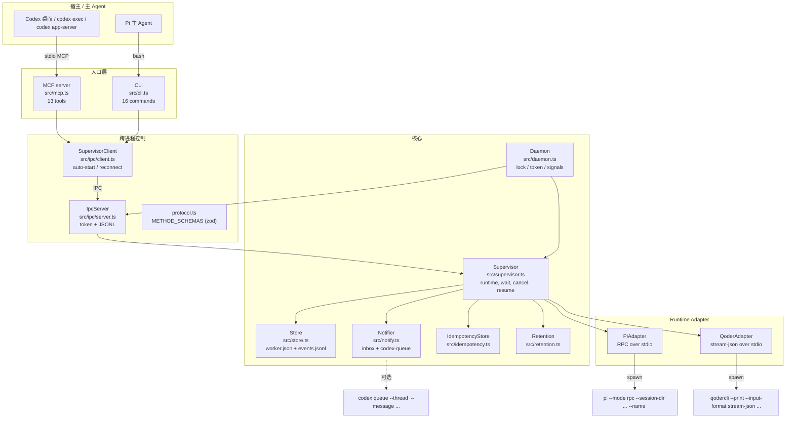
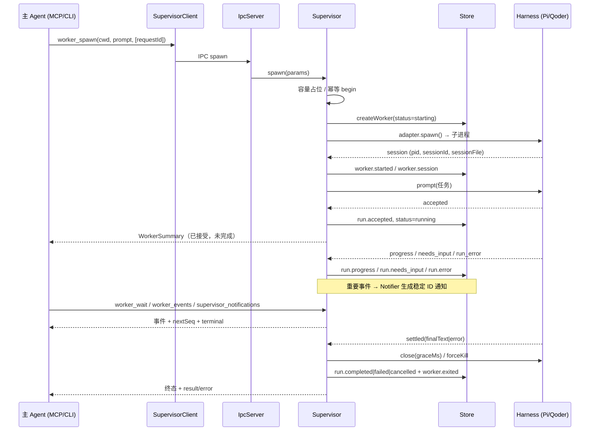
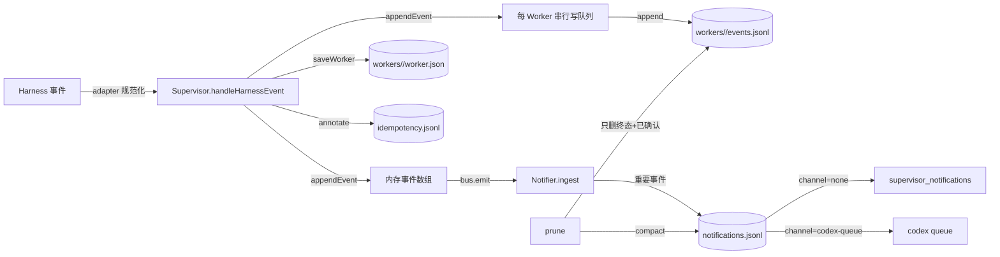

> **归档快照**：2026-10-22 的项目现状审计，保留当时的结论与数据，**不再更新**。
> 同日稍晚完成了 Codex 桌面端 A 级唤醒的单次验收，见 `evidence/desktop-wake-1022/`；
> 当前功能说明以仓库根目录的 `README.md` 为准。

# Harness Supervisor 项目现状审计与技术报告

- 审计日期：2026-10-22
- 审计对象：`D:/Projects/Harness-Supervisor`，分支 `feat-261022-async-notify`，HEAD `3d28ce7`
- 环境：Windows 11、Node v24.21.0、`codex-cli 0.161.0`、`qodercli 1.1.76`、Pi 1.3.0（历史证据）
- 性质：只读审计。未修改核心代码、未新增功能、未操作任何正在运行的 daemon、未提交/合并/推送。
- 说明：本报告基于当前仓库代码、测试与证据重新核查；不直接沿用此前的开发报告结论。凡引用历史证据均标注其目录与时间。

**状态标记约定**

| 标记 | 含义 |
| --- | --- |
| ①| 已实现且经过真实 E2E 验证 |
| ②| 已实现且通过自动化/模拟测试 |
| ③| 已实现但验证不足 |
| ④| 部分实现或存在明确缺陷 |
| ⑤| 尚未实现 |
| ⑥| 因外部宿主限制暂缓 |

---

## 1. 执行摘要

Harness Supervisor（HS）当前是一个**单用户、本地、运行时无关的 Worker 生命周期与事件管理层**：它用独立 OS 进程承载 Pi / Qoder CLI 的原生 Harness，对主 Agent 暴露 CLI 与 MCP 两套等价入口，并把生命周期事件规范化后持久化。v0.2 补上了三块"长期异步"能力：持久化通知收件箱、可选的 Codex 队列投递、可选的请求幂等；同时把 PID 对账从"存活检查"升级为"命令行身份校验"。

**当前事实（可复核）**

- Git：`feat-261022-async-notify` 相对 `main`（`a4ef1ca`）有 **6 个提交**、**45 个文件、+4748/−61 行**；`src/` 为 **14 个文件、+1850/−33 行**；未合并、未推送；工作树仅有未跟踪的 `.pi/`、`AGENTS.md`。
- 规模：`src/` 9,159 行 TypeScript；`test/` 5,023 行；运行时依赖仅 `@modelcontextprotocol/sdk`、`zod`（无新增）。
- 测试：本轮实际运行 `npm test` → **106 项，104 通过，0 失败，2 跳过**（跳过的是 `RUN_REAL_PI=1` 门控的真实 Pi E2E），耗时约 220s。
- 通知：重要事件（completed/failed/cancelled/needs_input/crashed/detached）生成 `<workerId>#<seq>` 稳定 ID 记录；默认收件箱只返回"未确认且待投递"；已确认记录在重连、重启、切换通道后都不会重发（单元 + 集成测试覆盖）。
- 唤醒：`codex queue --thread <id> --message <text>` + 已加载 thread = 宿主自动开始新 turn。已用真实 `codex app-server` 会话端到端验证（回合结束后 Worker 完成 → 投递 → 宿主自行开第二轮并读到结果）。**等级为 B（外部管理的受控会话）；A 级（用户桌面窗口）未验收。**
- Qoder：真实 1.1.76 上工具调用、取消+队列清理、AskUserQuestion 已验证；`steer`/`follow-up` 被 CLI 接受但未生效；`allow/deny` 未触发；静默窗口行为已用确定性测试固定。

**最重要的三个缺口**

1. **A 级桌面唤醒未验收**：机制成立，但"桌面窗口在回合结束后是否仍加载该 thread"只能由用户在自己的 Codex 会话中确认；未验收前不能宣称"能唤醒用户的桌面对话"。
2. **Qoder 交互语义不完整**：`run.message_sent` 只代表"被 stream 接受"，真实 steer/follow-up 未生效；权限 allow/deny 未真实走通；多轮 follow-up 未产生第二个 turn。
3. **长期运行的规模边界**：daemon 启动时把每个 Worker 的**全部事件读入内存**并长期保留（`src/store.ts:loadEvents`），事件总量随历史线性增长；`prune` 是显式操作，默认不自动清理。当前只测量到 120 Worker × 40 事件的量级（init 688ms、查询 <10ms），更大规模的启动时间与内存未测量。

**总体判断**：作为"daemon 持有、跨客户端断连、可观测、可取消、可恢复"的 Pi Worker 管理器，已具备日常使用条件；作为"能主动唤醒桌面主 Agent 的异步协作层"，仍处于 B 级 + 机制验证阶段；Qoder 仍为实验性。

---

## 2. 当前架构

### 2.1 组件关系



关键事实：

- **单一控制面**：CLI 与 MCP 都通过同一个 `SupervisorClient` 连接同一个 daemon；不存在两套状态（`src/ipc/client.ts`、`src/ipc/server.ts`）。
- **daemon 拥有进程**：Worker 是 daemon 的子进程，客户端断开不会终止 Worker（`test/integration/mcp.test.ts` 覆盖）。
- **协议层校验**：所有 IPC 参数经 `METHOD_SCHEMAS`（zod，`.strict()`）校验，未知字段被拒绝（`src/ipc/protocol.ts`）。
- **扩展入口**：新增 Harness 只需实现 `HarnessAdapter`（`src/types.ts`），并在 `src/daemon.ts` 注册；CLI/MCP/IPC 无需改动。

### 2.2 一个 Worker 的完整生命周期



状态机（`src/types.ts`）：

- 非终态：`starting → running ⇄ awaiting_input`。
- 终态：`completed` / `failed` / `cancelled` / `crashed` / `orphaned` / `interrupted`。
- 终态只有在 Harness 进程停止后才可见（`finalizeSettled` 先 close 再写状态）。
- `orphaned` = daemon 重启后记录的 PID 仍存活**且命令行身份匹配**；`interrupted` = 进程已丢失**或 PID 已被复用**（v0.2 新增身份校验，`src/supervisor.ts:init`）。
- Harness Session（Pi session 文件 / Qoder session id）与 Worker 记录解耦：`resume` 是"新进程 + 加载持久化 session + 新 prompt"，不是接管内存中的运行。

### 2.3 事件与通知的持久化流程



- 事件先进入内存与写队列，`flush` 后才视为已落盘；崩溃可能丢失最后一条异步写（`src/store.ts:flush`）。
- 通知记录与事件记录是**两次独立写入**；daemon 重启时会扫描已持久化事件补齐缺失通知，ID 由 `(workerId, seq)` 决定，因此不会重复（`Supervisor.reconcileNotifications`）。
- 通知默认通道为 `none`（纯本地收件箱），不产生任何外部调用。

### 2.4 模块划分

| 模块 | 职责 | 行数 |
| --- | --- | --- |
| `src/supervisor.ts` | 状态机、并发准入、等待、send/answer、取消、恢复、对账、通知 reconciliation | 1946 |
| `src/store.ts` | worker 记录、事件 JSONL、订阅、flush、stderr 尾 | 313 |
| `src/notify.ts` | 收件箱、ack、投递重试、压缩、消息渲染 | 576 |
| `src/idempotency.ts` | 请求幂等记录与状态机 | 299 |
| `src/retention.ts` | `prune` 策略与守卫 | 134 |
| `src/util/process.ts` | 跨平台命令行读取与身份判定 | 79 |
| `src/mcp.ts` | 13 个 MCP 工具、紧凑返回 | 578 |
| `src/cli.ts` | 16 个 CLI 命令 | 726 |
| `src/ipc/*` | 协议、server、client、daemon-state | 1049 |
| `src/adapters/pi/*` | Pi 启动、RPC session | 852 |
| `src/adapters/qoder/*` | Qoder 启动、stream-json session | 1621 |
| `src/daemon.ts` / `daemon-entry.ts` | 生命周期、环境配置、信号 | 206 |

**扩展入口**：`HarnessAdapter`（spawn/resume + `HarnessSession` 接口）、`METHOD_SCHEMAS`（新 IPC 方法）、`registerTool`（新 MCP 工具）、`case`（新 CLI 命令）。这四处是唯一需要同步修改的公共面。

### 2.5 HS 与 Codex 原生 Subagents 的实际能力差异

只陈述已验证差异，不作价值宣传：

| 维度 | Codex 原生 Subagents | HS 当前实现 | 证据 |
| --- | --- | --- | --- |
| 运行时 | 仅 Codex 自身 | Pi / Qoder CLI 各自的**原生进程与协议** | `src/adapters/*`；`evidence/qoder-real/`、`evidence/real-pi-worker/` |
| 进程所有权 | 宿主进程内/子代理 | 独立 daemon 持有，客户端断开后继续 | `evidence/codex-desktop-disconnect/`、`test/integration/mcp.test.ts` |
| 跨宿主运行 | 绑定 Codex 会话 | CLI 可从任何 shell / 其他 Agent 调用 | `evidence/parent-pi/`（父 Pi → CLI → 子 Pi） |
| 跨 daemon 重启 | 不适用 | 显式对账 + 身份校验 + 手动 resume（不自动重跑） | `test/integration/restart.test.ts`、`test/integration/pid-identity.test.ts` |
| 事件模型 | 宿主内部 | 统一 20 种事件 + 增量游标 + 持久化通知 | `src/types.ts`、`src/store.ts` |
| 异步交付 | 宿主内 | 本地收件箱（默认）+ 可选 `codex queue`（B 级） | `src/notify.ts`、`evidence/codex-wake-e2e/` |
| 取消 | 宿主管理 | 清队列 → abort/interrupt → 有界等待 → 强杀进程树 | `evidence/codex-desktop-cancel/`、`evidence/qoder-interactions/` |
| 幂等 | 无公开契约 | 可选 `requestId`：replay / CONFLICT / UNCERTAIN | `test/integration/idempotency.test.ts` |
| 沙箱 | Codex sandbox | **无 OS 隔离**，`cwd` 只是工作目录 | README §8 |
| 主动唤醒桌面 | 宿主内天然支持 | **未实现**（B 级机制已验证） | 见 §5 |

结论：HS 的差异点集中在**跨厂商、跨进程、跨客户端断连**的生命周期与事件层；它没有、也不打算替代宿主内部的 agent loop 或 Codex 的 subagent 编排。

---

## 3. 完整能力矩阵

### 3.1 基础生命周期

| 能力 | 状态 | 验证范围 | 备注 / 证据 |
| --- | --- | --- | --- |
| Worker Spawn | ①/② | 真实 Pi、真实 Qoder、模拟 harness | `test/integration/lifecycle.test.ts`；`evidence/qoder-real/` |
| 状态查询 | ① | 真实 Qoder/Pi | `status` 返回 worker + 最近事件 + stderr 尾 |
| 事件查询（游标） | ② | 模拟 + 真实会话 | `test/unit/jsonl.test.ts`、`store.test.ts` |
| 有界等待 | ② | 模拟；真实 Codex 使用过 | `worker_wait` 检查现状后再等待；`needs_input` 立即返回 |
| Steer | ①（Pi）/ ④（Qoder） | Pi 真实经 Codex E2E；Qoder 真实**未生效** | `evidence/codex-real-pi/`；`evidence/qoder-interactions/steer-immediate.txt` |
| Follow-up | ②（Pi）/ ④（Qoder） | Pi 仅模拟；Qoder 真实未产生第二个 turn | `test/integration/lifecycle.test.ts` |
| Answer / 交互输入 | ①（Pi、Qoder AskUserQuestion） | 真实 Qoder AskUserQuestion | `evidence/qoder-interactions/` |
| 权限审批 allow/deny | ②（协议）/ ③（真实） | Qoder 真实未触发；Pi 扩展对话框已模拟 | `test/integration/qoder.test.ts` |
| Cancel | ① | 真实 Codex 桌面取消、真实 Qoder 取消 | `evidence/codex-desktop-cancel/`、`evidence/qoder-interactions/` |
| Resume | ① | 真实 Pi、真实 Qoder | `evidence/real-pi-resume.txt`、`evidence/qoder-real/` |
| 并发容量控制 | ② | 模拟（含并发 spawn 竞态） | `test/integration/races.test.ts` |
| Shutdown | ② | 模拟 | 关停屏障、最多 5s 准入等待、取消/强杀、flush |
| Daemon 重启对账 | ② | 模拟（含 PID 复用） | `test/integration/restart.test.ts`、`pid-identity.test.ts` |
| 客户端断开/重连 | ① | 真实 Codex 桌面断开、MCP 断开 | `evidence/codex-desktop-disconnect/`、`mcp.test.ts` |
| 幂等请求 | ② | 模拟（含崩溃、并发） | `test/integration/idempotency.test.ts` |

### 3.2 多运行时

| 能力 | Pi | Qoder CLI |
| --- | --- | --- |
| 启动协议 | Pi RPC（`--mode rpc`），`①` 真实 | stream-json（`--print --input-format stream-json`），`①` 真实 |
| session 管理 | `--session-dir` / `--session`，`①` | `--session-id` / `--resume`，`①` |
| 多轮 | 原生队列（steer/follow-up），`①`（Pi→Codex E2E 中 steer 生效） | 单轮为主；follow-up 真实**未产生第二 turn**，`④` |
| 消息发送语义 | 进入 Pi 队列，`①` | 被 stream 接受（`run.message_sent`）但未影响运行，`④` |
| 工具事件 | `tool_start/tool_end`，`①` | 真实 Bash 调用事件，`①` |
| 取消 | clear_queue → abort → force kill，`①` | cancel_async_message → interrupt → 终止，`①` |
| 权限/提问 | extension dialog（select/confirm/input/editor），`②` | `can_use_tool` + AskUserQuestion；AskUserQuestion `①`，allow/deny `③` |
| Usage/token | **未采集**，`⑤` | `run.progress{kind:"usage"}`，`②`（未聚合） |
| 静默窗口 | 不适用 | 350ms / 1500ms，`②` 确定性测试（窗口内合并、窗口外早判定） |
| 特殊限制 | `.cmd` shim 不可作为 `HARNESS_SUPERVISOR_PI_BIN`；pause 不支持 | 无沙箱；session 布局依赖版本；权限模式不可用 bypass |

### 3.3 异步通知

| 能力 | 状态 | 说明 |
| --- | --- | --- |
| 事件类型 | ①/② | completed、failed、cancelled、needs_input、crashed、detached（`EVENT_KIND`） |
| 稳定 ID 与去重 | ② | `<workerId>#<seq>`；重启对账按同一 ID 补齐 |
| 查询 | ② | IPC `notifications` / MCP `supervisor_notifications` / CLI `inbox` |
| ack 语义 | ② | 默认收件箱与 `counts.pending` 排除已确认；重连/重启/切通道均不重发 |
| delivery 状态 | ② | pending / delivered / failed；记录 attempts、lastError、messageId |
| 自动重试 | ② | 仅 pending，有界次数与退避 |
| 手动重试 | ② | `states=["failed"]` 重置尝试预算 |
| 离线补投 | ② | 记录持久化，消费者重连后读取 |
| 重启恢复 | ② | 事件→通知 reconciliation；投递中断后重启补投 |
| `codex-queue` 通道 | ①（机制） | 官方 `codex queue`；at-least-once；只对已加载 thread 生效 |
| 本地收件箱 | ①/② | 默认通道，无外部依赖 |
| Windows toast | ⑤ | 未实现 |

### 3.4 可靠性与安全

| 能力 | 状态 | 说明 |
| --- | --- | --- |
| 请求幂等 | ② | replay / CONFLICT / UNCERTAIN / INVALID_STATE(running) |
| 并发竞态防护 | ② | 容量原子占位、resume 串行、cancel/send/answer 护栏 |
| PID 身份校验 | ② | 命令行 token 比对；不可读时回退 `orphaned` |
| 异常进程清理 | ① | 进程树/强杀；Qoder interrupt；Codex 宿主进程树限制已记录 |
| Session 恢复边界 | ① | 校验 session id 与文件；拒绝伪造成功 |
| 持久化保证 | ② | 追加 JSONL + 原子 worker.json；flush 语义 |
| 崩溃数据窗口 | ④ | 最后一次异步写可能丢失；幂等记录 `begin` 未同步 flush |
| 沙箱 | ⑥ | 无；`cwd` 不是隔离 |
| 脱敏 | ② | 静态模式（API key/Bearer/私钥/env）+ 截断 |
| Exactly-once | ⑤ | 明确不存在；投递 at-least-once |

### 3.5 长期运行

| 能力 | 状态 | 说明 |
| --- | --- | --- |
| 事件增长控制 | ④ | 无自动归档；每 Worker 事件全量常驻内存 |
| Prune | ② | 终态 + 已确认 + keep/dry-run + 可选 session 删除 |
| 活跃 Worker 保护 | ② | prune 跳过非终态 |
| 未确认通知保护 | ② | prune 跳过 unacked worker |
| 查询性能 | ③ | 120 Worker × 40 事件实测 <10ms；更大规模未测 |
| 大结果截断 | ② | result 64KB、事件文本 8KB、事件行 2MB、stderr 128KB |
| 远程 SSH/GPU/Slurm | ⑥ | 未验证；无授权主机 |

---

## 4. 两个 Runtime 的实际成熟度

### 4.1 Pi

- **启动与 session**：`buildArgs` 传 `--mode rpc --session-dir <state>/sessions/<workerId> --name <workerId>`，并可选 `--session <file>`（`src/adapters/pi/adapter.ts:110`）。真实证据：`evidence/real-pi-worker/`（2026-10-21，DeepSeek `deepseek-v4.1-flash-1017`）、`evidence/real-pi-resume.txt`（不调用模型的 session 加载校验）。
- **steer/follow-up**：真实 Codex → MCP → Pi 链路中 `CODEX_STEER` 生效（`evidence/codex-real-pi/`，`run.message_sent` seq 7）。
- **取消**：`clear_queue → abort → 有界等待 → 强杀`，真实桌面端取消证据 `evidence/codex-desktop-cancel/`。
- **交互输入**：extension dialog → `run.needs_input` → `worker_answer`，只有模拟测试覆盖（`test/integration/lifecycle.test.ts`）；无真实 Pi 扩展对话框 E2E。
- **Usage**：**未采集**。`src/adapters/pi/session.ts` 未映射 usage；`stats.turns/toolCalls` 是计数而非 token。
- **成熟度**：生命周期与恢复达到"日常可用"；交互输入与 usage 属于"已实现/未验证"与"未实现"。

### 4.2 Qoder CLI

- **协议**：真实 `qodercli 1.1.76` stream-json；`initialize`/`system init`/`assistant`/`result`/`control_request` 均已实测（`evidence/qoder-protocol-probe/`、`qoder-real-adapter-probe/`）。
- **启动/完成/resume**：`evidence/qoder-real/`（首轮 `QODER_E2E_OK`，resume `QODER_RESUME_OK`，session id 一致）。
- **工具调用**：真实验证，Bash 返回 `HS_QODER_TOOL_OK`（`evidence/qoder-interactions/summary.json`）。
- **取消 + 队列清理**：真实验证，`cancelled`、进程退出、排队 follow-up 未执行。
- **AskUserQuestion**：真实验证，`run.needs_input`（Red/Blue）→ 回答 Blue → 回复 `Blue.`。
- **steer / follow-up**：**消息被接受但未生效**。立即发送与延迟 1.5s 发送两种时机下最终答案均未包含指定 token；follow-up 未产生第二个 turn（`extraTurns=1`）。`run.message_sent` 语义已修正为"被 stream 接受，未被拒绝"，不等于"模型看到"。
- **权限 allow/deny**：`permission mode=default` 下 Bash `echo` 未触发 `can_use_tool`，因此未真实走通；仅模拟测试覆盖。
- **静默窗口**：`SETTLE_IDLE_MS=350`、`SETTLE_WITH_QUEUE_MS=1500`。已新增确定性测试：两个 result 间隔 200ms → 合并为一次终态（取最后一个结果）；间隔 2000ms → 先以第一个结果结束，迟到 result 被忽略且不产生第二次完成。**窗口外早判定是已知语义限制，不是缺陷修复目标**。
- **成熟度**：作为"单轮、可取消、可 resume、可观测"的 CLI Worker 已可用；多轮交互与权限审批仍不可依赖。

### 4.3 "协议接受" vs "模型处理" 的严格区分

| 信号 | 能证明 | 不能证明 |
| --- | --- | --- |
| `run.message_sent` | Supervisor 已成功写入 Harness 的 stdin/队列 | 模型看到了消息、或消息影响了输出 |
| `run.completed` | Harness 报告 settled（或进程退出后按规则判定） | 任务目标达成、文件/远程作业正确 |
| `delivery.state=delivered` | `codex queue` 返回成功并入队 | 桌面主 Agent 被唤醒或已读取 |
| `worker.result.text` | Harness 自述的最终文本 | 结果真实、测试通过、无副作用 |

本仓库现有文档已在 `src/adapters/qoder/adapter.ts` capabilities、MCP `worker_send` 描述、README §5、`docs/v0.2-report.md` 中明确这些边界。

---

## 5. 异步通知与 Codex 唤醒现状

### 5.1 通知模型

- **产生点**：`Notifier.ingest` 订阅 `Store.onAnyEvent`（`src/store.ts:onAnyEvent`），只对 6 类重要事件建记录；普通 `run.progress` 永不生成通知（300 条进度事件压力测试验证）。
- **记录内容**：`id`、`kind`、`eventType`、`workerId`、`runtime`、`seq`、`createdAt`、`summary`（终态文本/错误/requestId/问题/选项，最多 600 字符）、`delivery`、`ackAt/ackBy`。
- **确认语义**（v0.2 修复）：`list({state:"pending"})` 与 `counts.pending` 排除已确认记录；`deliver()`/`retryPending()` 跳过已确认记录。因此重连、切换通道、重启都不会重新触发已处理通知。
- **失败重试**：自动重试仅针对 `pending`（受 `maxAttempts` 限制，默认 3）；`failed` 必须显式重试（`retry-notifications --states failed`），重试会重置尝试预算。重试可能重复投递（at-least-once），已确认记录永不重发。
- **离线/重启**：记录先落盘；daemon 启动时扫描事件补齐缺失通知（稳定 ID），并重试 pending。

### 5.2 codex-queue 通道

```
Notifier.deliver
  → spawn(`<codexBin> queue --thread <threadId> --message "<one-line summary>"`, shell)
  → 退出码 0 ⇒ delivered（记录 messageId）
  → 非 0/超时 ⇒ pending（退避重试）或 failed（达到上限）
```

- 命令参数经过校验（thread id 正则）与清洗（单行、去引号、`cmd.exe` 引号处理），不会拼接任意用户输入到 shell。
- **要求 thread 已加载**：`codex queue` 只写入共享队列；只有当某个 app-server 客户端加载了该 thread 且 idle 时，队列才会被 drain 并开始新 turn。无加载时消息留在队列（`evidence/codex-wake-probe/` E1）。
- **at-least-once**：CLI 每次生成新的 `queuedSubmissionId`；崩溃窗口可能重复。

### 5.3 Codex 主动唤醒等级：**B**

| 问题 | 结论 | 证据 |
| --- | --- | --- |
| 能否让已结束回合的 Codex 继续？ | **能**（实验 Worker 为模拟 harness），但要求该 thread 由某个 app-server 客户端加载 | `evidence/codex-wake-e2e/result-late-worker.json`（回合 07:25:55 结束 → 07:26:35 投递 → 07:26:43 宿主自动开第二轮） |
| 能否唤醒用户现有桌面会话？ | **未验收** | 桌面窗口是否保持 thread 加载未测试；需用户确认 |
| 是否要求预先管理/加载 thread？ | **是** | E1（无客户端加载 → 不执行） |
| 是否额外消耗模型调用？ | **是**，每次唤醒都是一个新 turn（计入用户额度） | 实验未单独计量 |
| 是否可能重复处理/丢失？ | 重复可能（at-least-once）；丢失不会（持久化 + 重试），但 thread 长期不加载会一直 pending | `test/integration/notify.test.ts` |
| 权限/安全风险？ | 消息内容仅为 Worker 状态摘要；投递会把文本写入用户会话上下文；需用户授权启用通道 | `renderMessage` |

**明确：不得把 B 级描述为 A 级。** 当前 `supervisor_info.wake.proactive=true` 只表示"配置了通道"，不等于"已验证可唤醒桌面"。

---

## 6. 生命周期与可靠性

### 6.1 幂等语义（`src/idempotency.ts` + `Supervisor.withIdempotency`）

| 重复请求 | 行为 |
| --- | --- |
| 相同 key + 相同参数 + done | 返回 Worker 当前状态（或存储结果），不执行 |
| 相同 key + 相同参数 + failed | 重放同一错误（前缀 `Replayed result`） |
| 相同 key + 相同参数 + running | `INVALID_STATE`，不重复执行 |
| 相同 key + 不同参数 | `CONFLICT`（带 `firstSeenAt`） |
| 相同 key + 重启后 in_progress | `UNCERTAIN`，不自动重跑 |
| 无 key | v0.1 行为不变 |

- 参数 hash 基于规范化 JSON（排序键、忽略 `undefined`）。
- 前置错误（`BAD_REQUEST`/`UNSUPPORTED`/`INVALID_STATE`/`LIMIT_EXCEEDED` 且无 workerId）会释放 key，允许重试。
- **残留窗口**：`begin()` 通过 `void this.persist()` 异步落盘，未在操作前同步 `flush`。若进程在写盘完成前被强杀，记录可能不存在，携带同一 requestId 的重试会**再次执行**。当前测试用 800ms 延迟制造"已落盘"场景，未覆盖该更窄窗口。影响：极小概率的重复 spawn；修复成本低（`await begin + flush` 后执行），但会增加每次请求几毫秒延迟。

### 6.2 并发与竞态

- 容量：`reserveSpawnSlot` 在 `await` 前占位，`pendingSpawns` 计入上限，避免并发绕过（`test/integration/races.test.ts`）。
- resume：同一 Worker 的 resume 用 `resuming` Set 串行化；已有 runtime 时拒绝。
- cancel/send/answer：取消开始后拒绝新指令；重复 answer 被拒绝；取消幂等。
- 完成与取消竞争：以先到者为准，可能返回 `completed`（文档已声明）。
- 关闭屏障：`shutdown` 先拒绝新 spawn/resume/send/answer，最多等待 5s 准入，再取消/强杀。

### 6.3 PID 身份与异常恢复

- `inspectProcess(pid, tokens)`：Linux `/proc/<pid>/cmdline`；Windows `Get-CimInstance Win32_Process`；其他 POSIX `ps`。
- tokens = worker id / session id / session file。`verified=false` ⇒ 视为 PID 复用，对账为 `interrupted`，`cancel` 不杀进程并记录 `pid_identity_mismatch`；`resume` 不再被复用的 PID 阻塞。
- 读取失败 ⇒ `verified=null` ⇒ 保守 `orphaned`（不自动处理、不杀进程）。
- 已知不一致：`WorkerSummary.resumeAvailable` 仍用原始 `pidAlive` 判断（`Supervisor.summary`），因此"PID 复用但可 resume"时 `resumeAvailable` 可能为 `false`，与实际 `resume()` 行为不一致（轻微 UX 缺陷）。

### 6.4 持久化与崩溃窗口

- `worker.json`：原子写（临时文件 + rename）。
- `events.jsonl`：每 Worker 串行追加；最后一条异步写可能在强杀时丢失；重启忽略损坏尾行。
- 通知/幂等：追加日志；重启忽略损坏尾行；`compact()` 用原子重写。
- **不承诺 exactly-once**：事件、通知、投递、消息发送均为 at-least-once 或 at-most-once 的混合，已在 README 与报告中标明。

### 6.5 安全边界

- `cwd` 不是沙箱；Worker 与 daemon 同用户、继承环境变量，可访问 Superisor 状态目录与 `ipc.token`。
- IPC token：随机 32 字节，`timingSafeEqual` 比较；Windows 命名管道 / POSIX socket（权限受 umask 影响）。
- 同用户恶意进程不受 IPC token 保护（文档已声明）。
- 日志脱敏：API key/Bearer/私钥/env 模式；事件文本与结果截断。
- 工具 allowlist 不是安全边界（Pi `--tools` 仅是工具可见性）。

---

## 7. 测试及真实 E2E

### 7.1 本轮实测

- `npm test`（build + node --test）：**106 项，104 通过，0 失败，2 跳过**，220s；跳过项为 `RUN_REAL_PI=1` 门控的 `test/e2e/real-pi.test.ts` 与 `real-pi-resume.test.ts`。
- `npm run build`（`tsc -p tsconfig.json`）：通过。
- 未重新运行付费真实模型 E2E（Pi/Qoder/Codex），以避免额外费用；引用历史证据并标注环境与时间。

### 7.2 测试分布（按文件）

| 文件 | 用例数 | 类型 |
| --- | --- | --- |
| `test/unit/notify.test.ts` | 10 | ack/重试/压缩/投递 |
| `test/unit/idempotency.test.ts` | 6 | replay/conflict/uncertain/release/compact |
| `test/unit/process.test.ts` | 2 | 命令行读取与身份判定 |
| `test/unit/store.test.ts` | 4 | 持久化/游标/损坏尾行 |
| `test/unit/jsonl.test.ts` | 5 | 分帧/U+2028/CRLF |
| `test/unit/ipc-protocol.test.ts` | 4 | hello/信封/参数校验 |
| `test/unit/launch.test.ts` | 4 | Pi 启动参数与隔离 |
| `test/unit/qoder-launch.test.ts` | 5 | Qoder 环境/权限/配置根 |
| `test/unit/redact.test.ts` | 5 | 脱敏 |
| `test/integration/lifecycle.test.ts` | 7 | spawn/wait/send/answer/cancel/resume |
| `test/integration/races.test.ts` | 8 | 容量/取消/answer/队列 |
| `test/integration/restart.test.ts` | 3 | 崩溃对账/resume/关停 |
| `test/integration/failure.test.ts` | 2 | 启动失败/崩溃区分 |
| `test/integration/cli.test.ts` | 2 | CLI 全流程 |
| `test/integration/mcp.test.ts` | 2 | MCP 全流程/紧凑等待 |
| `test/integration/qoder.test.ts` | 11 | stream-json/权限/取消/静默窗口 |
| `test/integration/notify.test.ts` | 10 | 通知全场景 |
| `test/integration/idempotency.test.ts` | 7 | 幂等全场景 |
| `test/integration/retention.test.ts` | 3 | prune 守卫 |
| `test/integration/pid-identity.test.ts` | 2 | PID 复用 |
| `test/integration/perf.test.ts` | 2 | 120 Worker 延迟/大结果截断 |
| `test/e2e/real-pi*.test.ts` | 2 | 真实 Pi（门控跳过） |

### 7.3 真实 E2E 证据清单

| 证据 | 时间/环境 | 验证内容 | 局限 |
| --- | --- | --- | --- |
| `evidence/real-pi-worker/` | 2026-10-21，Pi 1.3.0，DeepSeek flash | 真实 Pi 完成并写文件 | 历史证据，本轮未重跑 |
| `evidence/real-pi-resume.txt` | 同上 | session 加载/ID 校验（无模型调用） | 不涉及模型 |
| `evidence/parent-pi/` | 同上 | 父 Pi → CLI → 子 Pi | 单机 |
| `evidence/codex-real-pi/` | Codex 0.161.0，Windows | Codex MCP → 真实 Pi，steer 生效 | `codex exec`，非桌面 |
| `evidence/coding-delegation/` | 同上 | Codex 委派编码任务给 Pi，测试 11/11 | 单任务 |
| `evidence/codex-desktop*/` | Codex 桌面（GPT-6 Luna） | spawn/steer/cancel/resume/断连 | 桌面端历史证据 |
| `evidence/codex-auto-start/` | Codex 0.161.0 | 自动启动 daemon 会被宿主进程树清理 | 负面证据 |
| `evidence/qoder-real/` | qodercli 1.1.76 | 真实 Qoder 完成 + resume | 纯文本任务 |
| `evidence/qoder-interactions/` | qodercli 1.1.76 | 工具/取消/AskUserQuestion；steer/follow-up 未生效；权限未触发 | 未覆盖 allow/deny |
| `evidence/codex-wake-probe/` | Codex 0.161.0 | queue 在有/无加载 thread 时的行为 | 机制探测 |
| `evidence/codex-wake-e2e/` | Codex 0.161.0 + HS，Worker 为模拟 harness（计划允许） | 回合结束 → Worker 完成 → 自动唤醒 | **app-server 会话，非桌面窗口** |
| `evidence/test-suite-v02.txt` | 2026-10-22 | 106/104/2 | 本轮审计复跑一致 |

### 7.4 覆盖盲区与 flaky 风险

- **未覆盖**：真实桌面 A 级唤醒、Qoder allow/deny、Qoder 多轮 follow-up、Pi extension 对话框真实链路、SSH/远程作业、POSIX/WSL 实机。
- **时序依赖**：竞态与 Qoder 测试使用固定 `sleep`（数百毫秒到数秒），在极慢机器上可能不稳定；本轮 3 次全量运行（62→93→106 项）均 0 失败，但未做重复压力运行。
- **内存/规模**：性能测试只到 120 Worker × 40 事件；没有 10k+ 事件或 1k Worker 的基线。
- **平台差异**：进程身份读取在 Windows 通过 PowerShell（依赖系统组件），Linux `/proc`、macOS `ps` 未实测。

### 7.5 文档一致性核对（发现的过期内容）

| 位置 | 问题 | 正确值 |
| --- | --- | --- |
| `README.md` §9（约 L526） | 写"62 tests，60 pass" | 当前为 106/104/2；该段还未列出 v0.2 新增测试 |
| `README.md` §9（约 L588） | 仍写 Qoder "真实 cancel 未验证" | cancel 已在 1.1.76 真实验证；steer 仍未生效 |
| `docs/v0.2-report.md` §7 | 写 40 个文件/+4232、src 13 个/+1767 | 实际 45 个/+4748、src 14 个/+1850 |
| `docs/v0.2-report.md` §8 | 只列 5 个提交 | 实际 6 个（漏 `3d28ce7`） |
| `docs/v0.2-report.md` §5 | 写"300 条进度" | fixture 为 150 组 tool_start/tool_end = 300 条 `run.progress`（表述应写"150 组/300 条"） |

这些属于文档准确性问题，不影响代码行为，但会误导后续判断，应在本轮之后修正（本轮按要求未改代码/未提交）。
---

## 8. 性能、资源与模型成本

### 8.1 已测量数据（Windows 本机，2026-10-22）

`test/integration/perf.test.ts` 数字来自 `t.diagnostic` 输出（本轮实测）：

| 指标 | 结果 | 条件 |
| --- | --- | --- |
| daemon 初始化（加载历史） | **688ms** | 120 Worker × 40 事件 = 4,800 条事件、120 个 worker.json |
| `list`（120 条） | **8ms** | 内存索引 + 克隆 |
| `status`（20 条最近事件） | **<1ms** | |
| `events`（limit 100） | **1ms** | |
| `notifications`（200 条） | **1ms** | 120 条通知 |
| 大结果截断 | record ≤64KB + 标记；事件文本 ≤8KB + 标记 | 200KB 模型输出 |

其他历史数据（非本轮重测，仅引用）：

| 指标 | 数值 | 来源 |
| --- | --- | --- |
| 真实 Qoder spawn 返回 | 约 9.7s | `evidence/qoder-real/test-run.txt` |
| 真实 Qoder 首轮完成 | 10.0s | 同上 |
| Codex 回合结束 → 队列 drain → 新 turn | 投递 07:26:35 → 新 turn 07:26:43（约 8s；机制探测中约 2.5s） | `evidence/codex-wake-e2e/`、`codex-wake-probe/` |
| `worker_wait` 紧凑化 | 10,936 字符/27 事件 → 4,047 字符/2 事件（省略 25 条进度） | README §9（历史测量） |
| MCP 全流程 Codex 用量 | 79,662 input / 301 output | `evidence/codex-real-pi/` |
| 编码委派用例 | Codex 239,581 input（199,552 cached）/891 output；Pi 45,896 tokens | `evidence/coding-delegation/` |

**未知项（不做推断）**：

- daemon 常驻 RSS、句柄数、CPU 占用：**未测量**。
- 每 Worker 的平均内存占用：**未测量**（事件全量常驻，见 8.3）。
- 大规模（1k Worker / 1M 事件）启动时间与查询延迟：**未测量**。
- 通知投递对主 Agent token 的实际增量：**未测量**。

### 8.2 通信开销

- IPC 为单连接 JSONL，请求/响应各一行；无轮询、无心跳。`worker_wait` 在挂起期间占用一个 pending request（最多 120s），不产生多余消息。
- MCP 每宿主会话一个 stdio 进程，常驻但空闲时不发消息；工具描述占用固定的上下文（约 1–2KB）。
- 事件文本、结果、stderr 均有硬上限，MCP 默认过滤 `run.progress`，避免把进度风暴塞进模型上下文。

### 8.3 存储与增长（重要）

按真实证据的每条事件平均大小 184–212 字节估算（`evidence/*/events.jsonl`）：

| 场景 | 事件数 | 估算磁盘 | 说明 |
| --- | --- | --- | --- |
| 单 Worker 正常任务 | 10–30 | 2–6KB | |
| 单 Worker 工具密集任务（假设 1,000 次工具调用） | ~3,000 | ~600KB | |
| 每天 20 个 Worker × 500 事件，保留 30 天 | ~300,000 | ~60MB | 仅 events.jsonl |
| 通知 | 每重要事件 1 条（约 0.5–1KB） | 与 Worker 数同阶 | 仅终态/输入等 |

**真正的规模问题不是磁盘，而是内存和启动**：

- `Store.init()` 对每个 Worker 读取**整个** `events.jsonl` 并解析全部行（`src/store.ts:loadEvents`），事件数组与 `records` 常驻内存直到进程退出。
- `prune` 可以删除整个 Worker 目录，但不会压缩单个 Worker 的事件文件；默认不自动执行。
- 因此长期运行（数天、大量工具进度）时：启动时间与 RSS 随**历史事件总量**线性增长；`getEvents` 每次读取用 `findIndex`，也是 O(n)。
- 当前实测只到 4,800 条事件；**10 万条以上事件的行为未知**，这是本报告认为最值得优先验证的工程风险之一。

### 8.4 模型成本

- HS 自身**不调用模型**（除可选 `codex queue` 投递会触发一次 Codex 新 turn）。
- 默认通知通道（本地收件箱）**零模型成本**；`codex-queue` 每成功投递一条通知 = 用户 Codex 会话多一个 turn，成本取决于该会话模型与上下文。
- Hem 不聚合 Pi 的 token 用量（未采集），Qoder 的 usage 只在 `run.progress{kind:"usage"}` 中出现且不汇总。因此**无法基于 HS 数据回答"节省了多少 token/额度"**。
- 上下文成本的主要控制手段是 `worker_wait` 默认省略进度、结果截断、事件游标；这些是"减少单次返回体积"，不等于"减少模型调用次数"。

### 8.5 代码复杂度评估

- 9,159 行 `src/`、5,023 行 `test/`，无新增运行时依赖，无数据库/队列服务。
- 职责边界总体清晰：`Supervisor`（生命周期）、`Store`（持久化）、`Notifier`（交付）、`IdempotencyStore`（请求去重）、`Retention`（清理）、`Adapter`（协议）。
- 明显复杂点：
  1. `src/supervisor.ts`（1,946 行）同时承担 spawn/resume 两条近乎重复的启动路径、取消状态机与对账，后续如需修改容易产生不一致（例如 spawn 与 resume 的错误分支处理并不完全对称）。
  2. `src/adapters/qoder/session.ts`（1,159 行）包含协议映射、权限、提问、settle 启发式与队列记账，是单文件复杂度最高的模块。
- 可能的简化（不影响当前功能）：
  - 把 spawn/resume 的公共段（占位、session 初始化、prompt 接受、失败回滚）抽成一个内部流程；
  - `Notifier` 与 `IdempotencyStore` 共享一个"追加日志 + 原子重写"的小工具（当前各有一份）；
  - 事件存储支持"只加载最近 N 条 + 按需回溯"，同时降低内存与启动成本。
- 为可靠性新增的复杂度（幂等、PID 身份、通知重试、prune 守卫）在当前问题域内是必要的，不属于过度设计；但**事件内存模型**与 **Qoder settle 启发式**是两处未来可能被替换的复杂点。

---

## 9. v0.1 → v0.2 演进（按真实 Git 历史）

### 9.1 提交时间线（`git log --oneline`）

```
3d28ce7 fix(notify,reliability): honour acks, retry failed delivery, verify process identity   ← v0.2 审计修复
3694c57 test(wake): end-to-end Codex wake via codex queue with real app-server session
1b02cd0 docs(qoder): real interaction evidence, wake probe, retention and idempotency docs
6352853 feat(retention): opt-in prune with safeguards and metadata compaction
6906aca feat(reliability): optional request idempotency for spawn/resume/send
8419e7c feat(notify): durable notification inbox with optional codex-queue delivery
a4ef1ca feat(qoder): add the experimental Qoder CLI adapter          ← main（origin/main）
04a7be7 test: add coding delegation evidence
5fa6e95 feat: compact MCP wait responses
322bbe6 test: add Codex desktop interaction evidence
0523e5d test: archive Codex desktop E2E evidence
c69d0d7 docs: remove duplicate tool list heading
3969a0b feat: make Codex MCP waits condition-aware
31ab8b3 fix: harden worker lifecycle races and recovery boundaries
86a0e87 chore: establish v0.1 baseline
```

另有独立分支 `feat-261022-qoder-cli-adapter`（`b3d88ba`，Qoder late-session 修复），**未合并**到 `main`；`main` 上的 Qoder 版本是 `a4ef1ca`。这意味着 `main` 缺少该分支的 session 记录修复，任何基于 `main` 的发布都会继承旧行为——这是分支管理层面的现状，不是代码缺陷。

### 9.2 v0.1 已具备

- Pi adapter（RPC）、daemon/IPC/CLI/MCP、增量事件、wait/send/answer/cancel/resume、并发与竞态加固（`31ab8b3`）。
- 真实证据：Pi Worker、父 Pi → 子 Pi、Codex `exec` → MCP → Pi、Codex 桌面 spawn/steer/cancel/resume/断连、编码委派。
- MCP 等待紧凑化（`5fa6e95`）与条件等待（`3969a0b`）。

### 9.3 Qoder Adapter 的引入

- `a4ef1ca`：stream-json adapter、启动参数隔离、权限模式、session 路径推导、resume 校验。
- 真实证据：协议探测（未登录）、启动失败路径、真实完成 + resume；`feat-261022-qoder-cli-adapter` 分支补了"首轮后才生成 session 文件"的修复（未合并）。
- 局限：steer/follow-up/权限审批当时均未真实验证。

### 9.4 v0.2 新增

| 提交 | 内容 |
| --- | --- |
| `8419e7c` | 通知收件箱、可选 codex-queue 投递、IPC/CLI/MCP 接口、`wake` 信息 |
| `6906aca` | 可选请求幂等（spawn/resume/send）、CONFLICT/UNCERTAIN、启动失败 fixture |
| `6352853` | `prune` 守卫、通知/幂等压缩 |
| `1b02cd0` | Qoder 真实交互证据、唤醒探测、文档 |
| `3694c57` | Codex 唤醒端到端实验与脚本 |
| `3d28ce7` | 审计修复：ack 语义、失败重试、PID 身份、Qoder 窗口测试、性能测试、报告 |

### 9.5 第一次独立审计拒绝的具体原因（实际）

1. **P0 通知确认语义错误**：默认 `notifications` 仍返回已确认记录；`retryPending` 不看 `ackAt`，切换通道会把已确认通知重新投递。
2. **失败投递不可恢复**：`retryPending` 只选 `attempts < maxAttempts`，`failed` 记录永久卡住。
3. **异常验收覆盖不足**：缺少"投递过程中 daemon 崩溃""通知文件丢失后重建""大量进度事件"测试。
4. **Qoder 静默窗口未被检查**：只有文档描述，没有确定性测试。
5. **PID 身份校验缺失**：仍只有存活检查。
6. **A 级唤醒描述不清晰**：机制验证容易被视为 A 级完成。
7. **缺少 9 项最终报告**（阶段状态表、接口兼容、代码量、Commit 清单等）。

### 9.6 拒绝后的修复（`3d28ce7`）

- `Notifier.list/counts/deliver/retryPending` 全面尊重 `ackAt`；新增 4 个单元/集成测试。
- 失败投递显式重试重置预算；自动重试保持有界。
- 新增：投递中杀 daemon 后补投、通知文件丢失后按稳定 ID 重建、150 组工具对（300 条进度事件）压力、Qoder 200ms/2000ms 双 result 确定性测试、PID 复用（含 cancel 诚实报错）、120 Worker 延迟、200KB 结果截断。
- `src/util/process.ts` + 对账/resume/cancel 集成。
- `docs/v0.2-report.md` 补齐 9 项报告，明确 B 级结论。

### 9.7 第二次审计通过的原因与保留意见

通过原因：上述 P0/P1 缺陷均有代码与测试证明修复；证据可复核；未验证能力被明确标注。

保留意见（非阻断）：文档数字过期（文件数、行数、提交数、进度条数）、幂等异步落盘窗口属于"缓解而非消除"、A 级/Qoder 权限/SSH 仍未验证。本报告 §7.5 已重新核对并列出。

### 9.8 当前仍保留的风险

见 §11；核心仍是：桌面唤醒未验收、Qoder 交互语义不完整、长期事件内存模型、跨平台未验证。

---

## 10. 原始目标完成度对账

| 原始目标 | 实际达到 | 依据 | 未达到部分 |
| --- | --- | --- | --- |
| **1. 支持不同模型搭配其原生 Harness** | Pi 完整、Qoder 实验性；两套原生协议、独立进程、独立 session | `src/adapters/*`；`evidence/qoder-real/`、`real-pi-worker/` | 第三个 runtime；ACP/IDE 集成；Qoder 多轮 |
| **2. 完整、可靠的生命周期管理** | spawn/status/events/wait/send/answer/cancel/resume/并发/关停/重启对账均已实现；Pi 有真实 E2E；取消与 resume 真实通过 | `test/integration/*`、`evidence/codex-desktop*/`、`qoder-interactions/` | 接管 daemon 崩溃后的原管道（明确不支持）；Qoder 权限；usage 采集；pause |
| **3. 重要事件与结果及时交还主 Agent** | 持久化收件箱（默认）+ 可选 `codex queue` 投递；B 级唤醒端到端验证 | `src/notify.ts`、`evidence/codex-wake-e2e/` | A 级桌面唤醒；即时性依赖 thread 加载；无 toast |

**衍生判断（基于功能与证据）**

- **主 Agent 能否自主发现并使用 HS？** 能：MCP `listTools` 可见 13 个工具，`instructions` 说明语义；但需要宿主已配置该 MCP server，且没有"自动注册/发现"机制。
- **是否减少人工复制粘贴？** 在 CLI/MCP 场景成立：结果、事件、状态都可程序化读取；但主 Agent 仍需主动调用工具，桌面端没有推送。
- **是否减少无价值监督？** 有界等待 + 事件游标 + 默认过滤进度，确实减少了"反复 status 轮询"；但在桌面端回合结束后，仍需用户/下次对话触发，或依赖未验收的 B 级队列投递。
- **是否支持长期异步工作？** Worker 层面支持（daemon 持有、跨客户端断连、可 resume）；**事件层面**支持持久化；但**主 Agent 层面的异步唤醒**只在 B 级成立。
- **跨会话协作体验？** 有持久化状态、通知、session resume；体验取决于宿主是否愿意加载 thread。
- **Keep Simple / Native Harness First / 向后兼容**：基本符合。新增 1.8k 行核心代码是为了 P0/P1 可靠性，不是框架化；接口以可选字段/新增方法扩展，旧客户端不受影响。偏离点：Qoder settle 启发式与 `run.message_sent` 的语义模糊，属于"为了统一接口而勉强对齐"的痕迹。

---

## 11. 未解决问题与风险（按优先级）

### P0（影响核心能力正确性/用户信任）

| # | 问题 | 为什么不够 | 用户影响 | 严重度 | 最小方案 | 依赖宿主 | 时机 |
| --- | --- | --- | --- | --- | --- | --- | --- |
| P0-1 | **A 级桌面唤醒未验收** | 只有 app-server 会话证据；桌面窗口是否保持 thread 加载未知 | 用户可能以为"回合结束后会自动继续"，实际不会 | 高 | 一次 GUI 验收脚本/清单：桌面会话创建 Worker → 回合结束 → 等待通知 → 观察是否自开新 turn；失败则明确降级为 C（收件箱+toast） | 是（Codex 桌面） | 现在 |

> 说明：本轮未发现新的 P0 级代码缺陷（通知/幂等/PID 的 P0 已在 `3d28ce7` 修复并通过审计）。P0-1 是能力验收缺口，而非代码错误。

### P1（明显影响日常使用/长期运行）

| # | 问题 | 为什么不够 | 用户影响 | 严重度 | 最小方案 | 宿主依赖 | 时机 |
| --- | --- | --- | --- | --- | --- | --- | --- |
| P1-1 | **事件全量常驻内存 + 启动全量读取** | `Store.loadEvents` 读取整个 JSONL；`prune` 不压缩单个 Worker 的事件文件 | 长期运行后 daemon 启动变慢、内存增长甚至 OOM，失去对 Worker 的控制 | 高 | init 只加载最近 N 条（如 500）+ `lastSeq`；`events` 回溯改按需读文件；增加 10 万事件基准 | 否 | 现在 |
| P1-2 | **Qoder `run.message_sent` 语义模糊** | 事件名暗示"已送达模型"，实际只是 stream 接受；steer/follow-up 未生效 | 调用方误以为任务已接受指导，产生错误决策 | 中高 | 语义拆分为 `run.message_queued`（Qoder）或增加 `delivered_to_model:false` 字段；MCP 返回提示 | 否 | 现在 |
| P1-3 | **幂等记录异步落盘窗口** | `begin()` 未在操作前 flush；极窄窗口内崩溃会导致重试再执行 | 极小概率重复 spawn/重复消息 | 中 | `begin` 后 `await flush()` 再执行（+ms 级延迟）；或改为同步原子写 | 否 | 现在（低成本） |
| P1-4 | **Pi 无 usage/token 采集** | 只有 turns/toolCalls 计数 | 无法做成本核算/预算控制 | 中 | 解析 Pi 的 usage 事件（若协议提供），或把 token 字段显式标为 unknown | 是（Pi 协议） | 下一步 |
| P1-5 | **`resumeAvailable` 与 PID 复用不一致** | summary 用原始 `pidAlive`，resume 用身份校验 | UI/Agent 看到 false 但实际可 resume | 低中 | summary 复用身份判定结果（或缓存最近一次判定） | 否 | 下一步 |

### P2（有价值，不影响当前核心）

| # | 问题 | 最小方案 |
| --- | --- | --- |
| P2-1 | 文档过期（README 的 62 tests、Qoder cancel 描述；report 的文件数/提交数） | 更新数字与措辞，保持与代码一致 |
| P2-2 | Windows 本地通知（C 级）缺失 | 可选 toast（PowerShell/Toast API），仅提醒不唤醒 |
| P2-3 | 单 Worker 事件文件无压缩 | 按 seq 保留最近 N 条 + 重要事件；保持游标单调 |
| P2-4 | acked 通知只在下一次 `prune` 时压缩 | 定时/阈值自动 compact（保留 30 天） |
| P2-5 | MCP 无"重试失败通知"工具 | 增加 `supervisor_notifications_retry`，与 CLI 对齐 |
| P2-6 | Qoder 静默窗口不可配置 | `HARNESS_SUPERVISOR_QODER_SETTLE_MS`，默认不变 |
| P2-7 | POSIX/WSL 未实测 | CI 或 WSL 冒烟：路径、socket 权限、进程身份 |

### 暂缓（外部条件/需求不足）

| 项 | 原因 |
| --- | --- |
| SSH/Slurm 科研 E2E | 无授权远程主机与凭据；HS 只应管理 Worker 进程 |
| 第三个 Runtime | 当前两个 runtime 的验证尚未收敛 |
| ACP/IDE 集成、Web UI | 与当前"轻量"定位冲突 |
| 自动重跑崩溃任务 | 明确禁止（可能重复副作用） |
| Exactly-once 投递 | 需要宿主事务语义，当前不宣称 |

---

## 12. 后续路线建议

### 12.1 如果现在停止开发，HS 是否适合日常使用？

**适合**（单用户、本机、可信代码）：

- 用 MCP/CLI 启动 **Pi** Worker 跑较长的编码/调研任务，期间做别的事，之后用 `worker_wait`/`status`/`notifications` 收结果。
- 需要多个并行 Worker（默认上限 8）并分别 steer/cancel。
- 客户端（Codex/CLI 会话）断开后任务继续，稍后重连查看。
- 需要可追溯的事件与最终结果、可恢复的 session。
- 任务失败/崩溃/取消时希望状态诚实（不虚报成功）。

**不适合**：

- 期望"回合结束后主 Agent 自动继续"的桌面体验（A 级未验收）。
- 依赖 Qoder 的 steer/follow-up/权限审批做多轮交互。
- 需要 OS 级隔离运行不可信代码。
- 需要 HS 直接管理远程 SSH/GPU/Slurm 作业生命周期。
- 需要多用户/团队共享或远程 MCP 认证。

### 12.2 最值得做的三件事（按顺序）

1. **完成 A 级桌面唤醒验收，并给出产品化降级路径**（1–2 天，含一次用户 GUI 操作）
   - 交付物：可重复的 GUI 验收清单；成功则记录 A 级证据与限制；失败则把默认体验定为"收件箱 + 可选 Windows toast"，并在 MCP 工具描述与 README 中明确。
   - 验收：桌面回合结束后 Worker 完成，桌面自动开新 turn 并引用 Worker 结果；或明确记录"桌面端不保持 thread 加载"的结论。

2. **解决长期运行的事件内存/启动规模问题**（2–3 天，无宿主依赖）
   - 交付物：`Store.init` 只加载最近 N 条事件 + `lastSeq`；`getEvents(sinceSeq)` 支持按需回溯；`prune` 后单 Worker 事件压实（保留重要事件）；10 万事件基准（启动时间、查询延迟、RSS 记录）。
   - 验收：10 万事件下 daemon 启动 < 2s、`status` < 100ms，内存不随历史事件线性增长；游标语义测试通过。

3. **收敛 Qoder 的交互语义**（2–4 天，部分依赖宿主）
   - 交付物：定位官方异步消息入口（或明确"1.1.76 不支持运行中 steer"并降级为单轮）；`run.message_sent` 语义拆分/标注；真实 allow/deny 复测（选择会触发审批的工具）；更新 capabilities/MCP/README。
   - 验收：至少一项运行中交互真实生效，或给出不可行的明确证据；权限 allow/deny 真实走通或明确标注不支持。

不建议现在做：第三个 runtime、Web UI、通用 ACP 层、自动任务重跑。它们会显著增加复杂度，而当前三个缺口更影响真实使用。

---

## 13. 最终评价

- **工程质量**：模块边界清晰、依赖极少、测试密度高（5k 行测试 / 9k 行源码），关键异常路径有回归测试；文档总体详尽但存在过期数字。
- **能力成熟度**：
  - Pi 生命周期管理：**可日常使用**（本地单用户、可信代码）。
  - 通知/幂等/清理：**已实现且测试充分**，剩余为规模与文档问题。
  - Codex 主动唤醒：**B 级可用，A 级未验收**；不能对外宣称"能唤醒桌面主 Agent"。
  - Qoder：**实验性**；单轮任务可用，多轮交互不可依赖。
  - SSH/科研与跨平台：**未验证/暂缓**。
- **最大风险**：宿主语义依赖（桌面加载状态、Qoder 消息处理）+ 长期事件内存模型；两者都不是当前代码的"崩溃型"缺陷，但会决定 HS 能否从"工具"变成"可靠基础设施"。
- **是否虚假繁荣**：不是。已实现能力有真实 E2E 或确定性测试支撑，未验证项均被显式标注；本轮审计未发现被掩盖的 P0 代码缺陷，但发现文档过期、幂等落盘窗口、事件内存模型、`resumeAvailable` 不一致等真实问题。

---

## 附录：审计方法

- 读取：`src/*`（全部核心模块）、`test/*`（测试与 fixture）、`README.md`、`AGENTS.md`、`docs/v0.2-report.md`、`evidence/**`。
- 运行：`npm test`（106 项）、`npm run build`、`test/integration/perf.test.ts` 诊断输出、Git 检查（`branch`/`log`/`status`/`worktree`/`diff --stat`）。
- 未运行：付费真实模型 E2E（Pi/Codex/Qoder）、GUI 操作、任何 daemon 启停（除测试内部临时 daemon）。
- 数据来源均标注于正文；未测量项明确写为"未知"。
